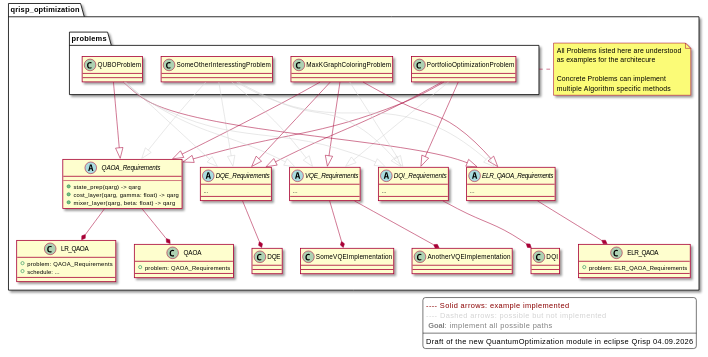

# qrisp-optimization

!!! warning "Work in progress"
    This project is a proof of concept. Breaking changes are likely.

A flexible architecture for solving combinatorial optimization problems with
different quantum(-inspired) algorithms built on [Eclipse Qrisp](https://qrisp.eu). It is designed to:

- separate **problem definitions** from **algorithm implementations**,
- use **requirements interfaces** to express what an algorithm needs from a problem,
- make it easy to add new problems and new algorithm variants.

## Core concepts

**Requirements** are abstract interfaces an algorithm declares, e.g.
[`QAOARequirements`][qrisp_optimization.QAOARequirements] or
[`BruteforceRequirements`][qrisp_optimization.BruteforceRequirements].

**Problems** live in [`qrisp_optimization.problems`](api/problems.md) and
implement one or more requirements interfaces.

**Algorithms** such as [`QAOA`][qrisp_optimization.QAOA],
[`LRQAOA`][qrisp_optimization.LRQAOA] and [`Bruteforce`][qrisp_optimization.Bruteforce]
depend only on a requirements interface, never on a concrete problem class.

## Guides

- [Solve an existing problem with an existing algorithm](guides/solve-existing-problem.ipynb)
- [Solve a new problem with an existing algorithm](guides/new-problem.ipynb)
- [Solve an existing problem with a new algorithm](guides/new-algorithm.ipynb)
